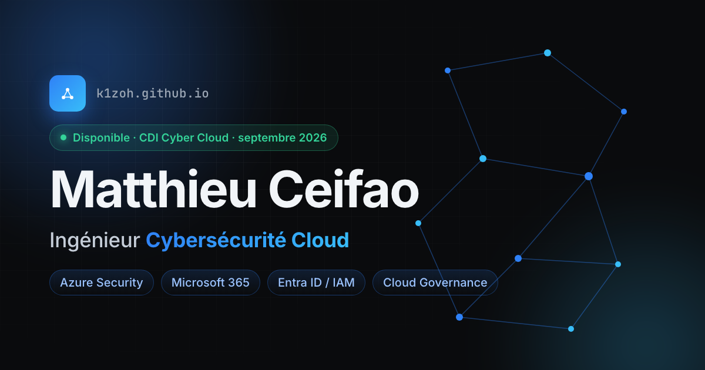

# k1zoh.github.io

Personal portfolio and web CV of **Matthieu Ceifao** (KiZoh), junior Cloud Cybersecurity Engineer (Azure / Microsoft 365 / IAM).

**Live:** https://k1zoh.github.io



## About

A single-page, bilingual (FR / EN) portfolio built as a front-end proof of work. No tracker, no backend, fully static, deployed on GitHub Pages.

## Features

- Bilingual content (FR / EN) with a language toggle
- Dark and light themes via CSS design tokens, no flash on load
- Animated cyber-network canvas hero and a neofetch-style system card
- Scroll-spy navigation with a mobile menu
- One-click "Download CV" (clean print-to-PDF layout)
- Accessibility: honours `prefers-reduced-motion`, visible focus states, semantic structure
- `Person` JSON-LD structured data for SEO

## Stack

React 19 · TypeScript · Vite · Framer Motion · Lucide · plain CSS (custom properties). No UI framework.

## Run locally

```bash
npm install
npm run dev      # http://localhost:5173
npm run build    # production build to /dist
npm run lint
```

## Structure

```
src/
  components/   layout, hero, sections, ui primitives
  context/      theme + language providers
  hooks/        reduced-motion, scroll-spy
  i18n/         FR/EN content (single source of truth)
  styles/       tokens, base, components, print
```

## Notes

Internal figures from past roles are intentionally kept vague (no confidential data). Built with help from Claude Code.

© Matthieu Ceifao
